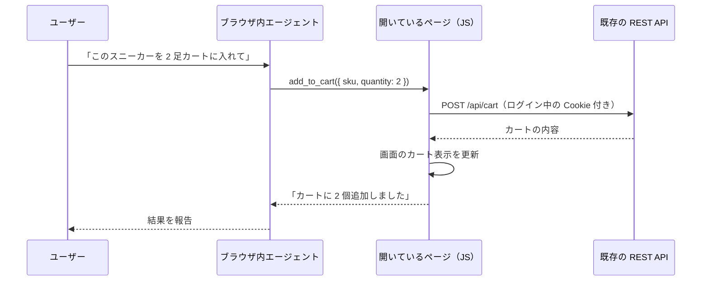

## はじめに

WebMCP は、Chrome 149 で Origin Trial が始まり、ChatGPT のデスクトップアプリにも搭載されたことで、2026 年に入って急に「試せる技術」になりました。Zenn でも 9 月以降、触ってみた記事が増えています。

一方で、Web サービスを作っている立場からは次のような疑問が湧きます。

- WebMCP は「AI 向けの新しい API」なので、REST API の代わりになるのか
- 自分のサービスに入れると、何がうれしいのか
- どんな画面・機能に向いているのか

本記事では、仕様リポジトリ（[webmachinelearning/webmcp](https://github.com/webmachinelearning/webmcp)）の原文と Chrome の公式ドキュメントを一次ソースとして、この 3 点を整理します。

先に結論を書くと、**WebMCP は REST API の代わりではありません**。ユーザーがブラウザで開いているページが、そのブラウザ内の AI エージェントに機能を公開する仕組みで、既存の REST API の「上に載る層」です。

:::message
WebMCP は W3C の Web Machine Learning Community Group で策定中の Draft Community Group Report で、W3C の標準化トラックには乗っていません。API はこの 1 年で何度も変わっています。本記事は 2026 年 10 月 15 日時点の仕様に基づいています。
:::

## WebMCP とは

WebMCP は、Web ページが JavaScript の関数を「ツール」として AI エージェントに公開するための Web API です。エージェントは画面のスクリーンショットを見てボタンの位置を推測する代わりに、型付きのツールを直接呼び出せます。

現行の仕様では、`document.modelContext` に次の 3 メソッドがあります。

| メソッド | 役割 |
|---|---|
| `registerTool(tool, options)` | ツールを登録する（ページ側） |
| `getTools(options)` | 登録済みのツール一覧を取得する（ページ内のエージェント向け） |
| `executeTool(tool, input, options)` | ツールを実行する（ページ内のエージェント向け） |

ほかに、`toolchange`・`toolactivated`・`toolcancel` の 3 つのイベントがあります。

### 最小のコード例

EC サイトで「カートに追加」をツールとして公開する例です。

```js
const controller = new AbortController();

await document.modelContext.registerTool({
  name: 'add_to_cart',
  description: '指定した商品をカートに追加します。商品IDは search_products で取得してください。',
  inputSchema: {
    type: 'object',
    properties: {
      sku: { type: 'string', description: '商品ID' },
      quantity: { type: 'number', description: '個数（1〜10）' },
    },
    required: ['sku'],
  },
  annotations: {
    readOnlyHint: false,     // 状態を変更する
    consequentialHint: false, // 取り消せない重大な操作ではない
  },
  execute: async ({ sku, quantity = 1 }) => {
    // 既存の REST API をそのまま呼ぶ（ログイン中の Cookie も使われる）
    const res = await fetch('/api/cart', {
      method: 'POST',
      headers: { 'Content-Type': 'application/json' },
      body: JSON.stringify({ sku, quantity }),
    });
    const cart = await res.json();
    renderCart(cart); // 画面のカート表示も同時に更新する
    return `カートに ${quantity} 個追加しました（合計 ${cart.items.length} 品目）`;
  },
}, { signal: controller.signal });

// ページを離れる・機能が使えなくなったときは登録を解除する
// controller.abort();
```

ポイントは 3 つあります。

- **`execute` の中身は普段のフロントエンドのコードです。** 既存の `fetch` や画面更新の処理を再利用できます
- **登録解除は AbortSignal で行います。** 以前の仕様にあった `unregisterTool()` は現行の仕様には存在しません
- **`annotations` でツールの性質を伝えます。** `readOnlyHint`（読み取り専用）、`untrustedContentHint`（ユーザー投稿など信頼できない内容を返す）、`consequentialHint`（予約や送金など取り消せない操作）があり、ブラウザやエージェントはこれを見てユーザーに確認を求めるかどうかを判断します

TypeScript を使う場合は、Chrome のドキュメントで紹介されている `webmcp-types` パッケージで型定義を入れられます。

## ウェブサービスとして使えるか

ここが一番誤解されやすい点です。

### エンドポイントは存在しない

WebMCP には URL もプロトコルもありません。ツールは**ユーザーのブラウザで開いているタブの中**にだけ存在し、呼び出せるのはそのブラウザに組み込まれたエージェント（またはページ内のエージェント）だけです。

そのため、次のような使い方はできません。

- 外部のサーバーから WebMCP のツールを呼ぶ
- 夜間バッチでツールを実行する
- 他社の SaaS と連携する窓口として公開する

仕様の explainer も、これをはっきり対象外（Non-Goal）にしています。

> The API is not intended for fully autonomous agents where a browser UI is not present

出典: [WebMCP explainer — Goals & Non-Goals](https://github.com/webmachinelearning/webmcp/blob/main/README.md)

同じ箇所には「既存のバックエンド向けプロトコル（MCP など）の置き換えではなく補完である」とも書かれています。

### 既存の REST API の上に載る層

「自分の Web サービスに WebMCP を足す」という意味でなら使えます。その場合の構成は次のとおりです。



REST API は今までどおりサーバーにあり、WebMCP はフロントエンドの JS がそれを呼ぶ処理を、エージェントから使えるようにするだけです。

### 試すにはトークンかフラグが必要

Chrome では、Origin Trial のトークンをページに設定するか、ローカル開発用のフラグ `chrome://flags/#enable-webmcp-testing` を有効にしないと API が公開されません。

実際に、トークンもフラグもない Chromium 152 ベースのブラウザで確認すると、どちらも存在しませんでした。

```js
'modelContext' in document  // false
'modelContext' in navigator // false
```

本番のユーザーに使ってもらうには、Origin Trial に登録してトークンを配信する必要があります。

## REST API・MCP サーバーとの比較

| | REST / OpenAPI | MCP サーバー | WebMCP |
|---|---|---|---|
| 動く場所 | サーバー | サーバー / ローカルプロセス | ユーザーのブラウザのタブ内 |
| 呼び出し元 | 任意のクライアント | AI プラットフォーム | そのブラウザのエージェントだけ |
| 認証 | API キー・OAuth を別途用意 | 同左 | ログイン済みのセッションをそのまま使う |
| 画面との同期 | なし | なし（裏で状態が変わる） | ツール実行と画面更新が同じコード |
| 新しいサーバー | 必要 | 必要 | 不要（フロントの JS を再利用） |
| ツールの出し分け | 静的 | ほぼ静的 | ページの状態に応じて動的に登録・解除 |
| 自動化・バッチ | 得意 | 得意 | 対象外 |

Chrome のドキュメントも、MCP との関係を次のように説明しています。

> WebMCP is not an extension or a replacement of MCP.

出典: [When to use WebMCP and MCP](https://developer.chrome.com/docs/ai/webmcp/compare-mcp)

同じページでは「MCP はバックエンド、WebMCP はフロントエンド」と整理されています。

### WebMCP のメリット

explainer は、MCP や OpenAPI のようなバックエンド連携の課題として「UI を素通りして文脈が失われる」「状態と認証を別のサーバーに作り直す必要がある」「専用のバックエンドを書く負担」の 3 つを挙げています。WebMCP のメリットはその裏返しです。

1. **認証や状態を作り直さなくてよい**
   エージェント用に OAuth のクライアントを用意したり、ユーザーが今見ている画面の文脈をサーバー側で再現したりする必要がありません。ログイン中のセッションがそのまま使われます。

2. **画面とずれない**
   バックエンドの MCP でカートに商品を追加すると、サーバーの状態は変わっても、ユーザーが見ている画面は古いままです。explainer の図にも「バックエンドの状態が、見えている画面と食い違う可能性がある」と書かれています。WebMCP ではサイト自身のコードが処理と画面更新を一緒に行います。

3. **ユーザーが見ながら任せられる**
   explainer の最初の Goal は human-in-the-loop です。エージェントが操作した結果が画面にそのまま出るので、ユーザーは途中で確認・修正できます。決済のような重要な操作は、最後のボタンだけユーザーに押してもらう設計にできます。

4. **画面操作の自動化より速く、壊れにくい**
   スクリーンショットや DOM を読み取ってクリックを再現する方式は、デザインが変わると壊れます。WebMCP では型付きの関数呼び出しになります。

5. **追加の実装が少ない**
   既存の UI ロジックや REST 呼び出しを `execute` で包むだけで済みます。

## 利用ケース

explainer と Chrome のドキュメントに載っている例を整理すると、4 つの系統に分かれます。共通しているのは、**ユーザーがログインした画面を見ながら、操作をエージェントに任せる**場面だということです。

### 1. EC・購入

公式ドキュメントで最も手厚く扱われている分野です。

- **条件付きの絞り込み**：「自分のサイズで、カクテルドレスコードの結婚式に合うドレスだけ見せて」と頼むと、エージェントが商品データを取得するツールで候補を集め、一覧を絞り込むツールで画面を更新します。手持ちの服の写真を渡して「これに似たもの」と頼む例もあります（explainer）
- **複数店舗をまたぐ買い物リスト**：商品検索、価格帯での絞り込み、ほしいものリストへの追加をツールにして、最後の決済はユーザーが行います（Chrome docs）
- **前回と同じものの再注文**：「先月買ったチーズスティックをもう一度」と頼むと、注文履歴の取得 → カートへの追加の順にツールが呼ばれます（Chrome docs）

```js
// 注文履歴を返す読み取り専用ツールの例
await document.modelContext.registerTool({
  name: 'get_order_history',
  description: '指定期間の注文履歴を返します。商品名・注文日・配送状況を含みます。',
  inputSchema: {
    type: 'object',
    properties: {
      startDate: { type: 'string', description: '開始日（YYYY-MM-DD）' },
      endDate: { type: 'string', description: '終了日（YYYY-MM-DD）' },
    },
  },
  annotations: { readOnlyHint: true },
  execute: async ({ startDate, endDate }) => {
    const res = await fetch(`/api/orders?from=${startDate ?? ''}&to=${endDate ?? ''}`);
    return JSON.stringify(await res.json());
  },
});
```

### 2. 長いフォームの入力

Chrome のドキュメントでは、タイムシート・経費の入力、中古車の条件検索、保証の申請、イベント業者への一括問い合わせが紹介されています。保証の申請の例では、「申請の開始」「製品情報の入力」「不具合内容の記述」「連絡先の入力」をツールに分けることで、ユーザーは申請フォームがどこにあるかを知らなくても手続きを終えられます。

:::message alert
Chrome のドキュメントのフォーム例は、`<form toolname="..." tooldescription="...">` のような**宣言的 API**で書かれています。しかし宣言的 API は 2026 年 10 月 8 日に仕様本体から外され（[PR #338](https://github.com/webmachinelearning/webmcp/pull/338)）、explainer での検討扱いに戻りました。今から実装するなら、`registerTool` を使う命令的 API で書いておくほうが安全です。
:::

### 3. 制作系の Web アプリ

explainer には、デザインツールでチラシを作る例があります。

1. テンプレートを自然言語で絞り込むツールで、画面の一覧を更新する
2. テンプレートを選ぶと、編集用のツールが**その時点で動的に登録**される
3. エージェントが編集をまとめて適用し、変更は「未確定」の状態で画面に表示される。ユーザーが確認してから確定する
4. 最後に印刷注文のツールで、決済画面まで進める

ページの状態に応じてツールを出し入れできるのは、静的な API 定義にはない WebMCP の特徴です。Chrome の公式デモ集（[GoogleChromeLabs/webmcp-tools](https://github.com/GoogleChromeLabs/webmcp-tools)）にも、ピクセルアート、スプレッドシート、ピザメーカー、不動産の地図などの例があります。

### 4. 業務・開発者向けの複雑な画面

explainer にはコードレビューツール Gerrit の例があります。「Mac と Android のトライボットはなぜ落ちている？」と聞くと、エージェントがトライボットの状態と失敗ログを取得するツールを呼んで原因を説明します。修正案は差分を提案するツールでレビュー画面に表示され、採用するかどうかは人が決めます。

メニューが深く、初めて使う人が迷いやすい業務画面ほど、効果が大きい分野です。

### 仕組みから派生する使い方

- **ページ内の独自エージェント**：`getTools()` と `executeTool()` を使えば、自社サイトに組み込んだチャットボットからも同じツールを呼べます。ブラウザ内蔵のエージェントと自社の bot が、同じツール定義を共有できます
- **埋め込みウィジェットとの連携**：`registerTool` の `exposedTo` オプションで信頼できる origin を指定すると、iframe で埋め込んだ予約・地図などのウィジェットのツールを、親ページ側でも使えるようになります。クロスオリジンの iframe は、Permissions Policy の `tools` で既定では無効になっています
- **ブラウザ以外のエージェント**：仕様リポジトリの実装状況ページには、Meta Ray-Ban Display のメガネに載った Meta AI が `registerTool` で登録されたツールを呼べるようになる予定（近日対応）と書かれています
- **テスト・デバッグ**：`annotations` の `debugging: true` は、テストフレームワークや DevTools の AI 支援向けのツールであることを示します（Chrome 156 から）

## 向いている場面・向いていない場面

| 向いている | 向いていない |
|---|---|
| ログインが必要で、画面上の状態（カート、編集中のデータ）を使う操作 | ログイン不要の公開データの取得（REST や MCP で十分） |
| 絞り込みや入力など、手順は多いが最終判断はユーザーがしたい操作 | 夜間バッチや外部システム同士の連携 |
| 結果を画面ですぐ確認したい操作 | 画面が存在しない処理 |
| メニューが深く、初めての人が迷う業務画面 | ボタン 1 つで終わる単純な操作 |

日本のサービスに当てはめると、会計・経費精算の SaaS（「先月の交通費を登録して」）、飲食・美容・宿の予約サイト（空き検索と条件入力までを任せ、確定は人が押す）、社内の受発注・管理画面などが候補になりそうです。これは筆者の推測で、公式の例ではありません。

## 導入前に知っておきたいこと

### 対応環境はまだ限られる

仕様リポジトリの [implementation-status.md](https://github.com/webmachinelearning/webmcp/blob/main/implementation-status.md) と [Chrome Status](https://chromestatus.com/feature/5117755740913664) で確認できる状況は次のとおりです。

| 環境 | 状況 |
|---|---|
| Chrome | Origin Trial（M149〜156、M162 まで延長） |
| Edge | Origin Trial（Edge 150） |
| ChatGPT Desktop | 対応 |
| Brave | Leo AI で実験的に対応 |
| Firefox | Mozilla の standards-positions は neutral（中立） |
| Safari | WebKit の standards-positions は oppose（反対） |

WebKit の反対理由は、「エージェントにとって操作しづらいのはページの意味づけが足りないからで、HTML や ARIA のような共通の層で直すべき。エージェント専用の層を並行して作るのは正しくない」というものです（[WebKit/standards-positions#670](https://github.com/WebKit/standards-positions/issues/670)）。ツールの選択がエージェントによる自然言語の name と description の解釈に頼っている点も、懸念として挙げられています。

### API はまだ動いている

仕様の `index.bs` のコミット履歴を追うと、この 1 年で大きな変更が続いています。

| 日付 | 変更 |
|---|---|
| 2026-02-19 | `navigator.modelContext` として初期化 |
| 2026-03-05 | `provideContext()` と `clearContext()` を削除 |
| 2026-03-26 | `registerTool()` が AbortSignal を受け取るように |
| 2026-05-27 | `modelContext` の getter を `Document` に移動 |
| 2026-07-21 | `annotations` を別オブジェクトに分離、`getTools()` を仕様化 |
| 2026-08-14 | `executeTool()` を仕様化 |
| 2026-10-08 | 宣言的 API を仕様本体から削除 |

ネット上の解説で `navigator.modelContext` や `provideContext()`、`unregisterTool()` を使っているものは、現行の仕様とは合いません。実装するときは仕様と Chrome のドキュメントの更新日を必ず確認してください。

### ツールは少なく、説明は具体的に

explainer のベストプラクティスでは、登録したツールの name・description・inputSchema はすべてモデルのトークンを消費するため、数十〜数百のツールを公開するとエージェントの精度が大きく落ちる可能性があると注意しています。ページの状態に関係するツールだけを動的に登録し、不要になったら AbortSignal で解除するのが推奨です。

また、ツールが返す内容にユーザー投稿のような信頼できないデータが含まれる場合は `untrustedContentHint` を、予約や送金のような取り消せない操作には `consequentialHint` を付けることが、Chrome の[セキュリティガイド](https://developer.chrome.com/docs/ai/webmcp/secure-tools)で推奨されています。

## まとめ

- WebMCP は、開いているページが JavaScript の関数を「ツール」としてブラウザ内のエージェントに公開する Web API です
- エンドポイントはなく、外部から呼べる Web サービスにはなりません。**REST API の代わりではなく、その上に載る層**です
- メリットは、ログイン中のセッションをそのまま使えること、画面とずれないこと、ユーザーが見ながら任せられること、既存のフロントエンドのコードを再利用できることです
- 向いているのは EC、長いフォーム、制作系アプリ、複雑な業務画面など、**ユーザーがログインした画面で、操作をエージェントに任せたい**場面です
- 対応環境は Chrome・Edge の Origin Trial と ChatGPT Desktop が中心で、Safari（WebKit）は反対の立場です。API もまだ変わり続けています

自社サービスでまず試すなら、既存の検索や絞り込みのような読み取り専用の操作を `readOnlyHint: true` のツールとして 1〜2 個公開し、フラグを有効にした Chrome で動かしてみるのがおすすめです。

## 参考リンク

- [WebMCP 仕様（Draft Community Group Report）](https://webmachinelearning.github.io/webmcp/)
- [webmachinelearning/webmcp（explainer・実装状況）](https://github.com/webmachinelearning/webmcp)
- [Chrome for Developers: WebMCP](https://developer.chrome.com/docs/ai/webmcp)
- [Chrome for Developers: Imperative API](https://developer.chrome.com/docs/ai/webmcp/imperative-api)
- [Chrome for Developers: How WebMCP fits in user journeys](https://developer.chrome.com/docs/ai/webmcp/use-cases)
- [Chrome for Developers: When to use WebMCP and MCP](https://developer.chrome.com/docs/ai/webmcp/compare-mcp)
- [Chrome for Developers: WebMCP tool security](https://developer.chrome.com/docs/ai/webmcp/secure-tools)
- [WebMCP origin trial の告知（2026-06-09）](https://developer.chrome.com/blog/ai-webmcp-origin-trial)
- [GoogleChromeLabs/webmcp-tools](https://github.com/GoogleChromeLabs/webmcp-tools)
- [WebKit/standards-positions#670](https://github.com/WebKit/standards-positions/issues/670)
- [mozilla/standards-positions#1412](https://github.com/mozilla/standards-positions/issues/1412)
