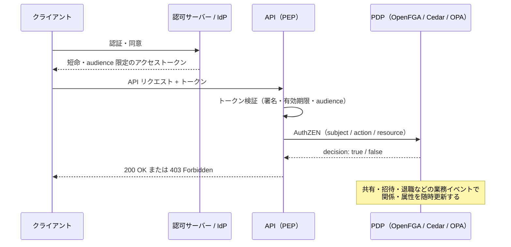

## はじめに

[OWASP Top 10:2025](https://top10.owasp.org/2025) でも、A01 は引き続き **Broken Access Control** です。認証の仕組みは IdP（Keycloak、Auth0、Cognito、Entra ID など）を入れれば整いますが、「誰が・どのリソースに・何をしてよいか」の判定は、いまも多くのアプリで各エンドポイントの if 文に散らばっています。

よくある「解決策」は、IdP のトークンに `roles` や `groups` を詰め込み、API 側でそのクレームを見て判定する方法です。手軽ですが、この構成はリソース単位の権限や権限の剥奪に弱く、規模が大きくなると破綻しがちです。

本記事では、2025〜2026 年に出揃った次の一次ソースをもとに、認可基盤の責務分担を整理します。

- [RFC 9700 — Best Current Practice for OAuth 2.0 Security](https://www.rfc-editor.org/rfc/rfc9700.html)（2025 年 1 月、BCP 240）
- [OpenID AuthZEN Authorization API 1.0](https://openid.net/specs/authorization-api-1_0.html)（2026 年 1 月 12 日 Final 承認）
- [OWASP Authorization Cheat Sheet](https://cheatsheetseries.owasp.org/cheatsheets/Authorization_Cheat_Sheet.html)

先に結論を書きます。

- **認可サーバー（AS）／IdP** は「誰か」と「どのリソース向けのトークンか」までを担当し、トークンは短命・audience 限定・最小権限にする
- **PDP（Policy Decision Point）** を別に立て、「この操作をしてよいか」を毎リクエスト判定する
- アプリ（PEP）と PDP の間は **AuthZEN** で繋ぎ、PDP の実装（OpenFGA、Cedar、OPA など）を差し替え可能にする

後半では、OpenFGA と Cedar を実際に動かした結果も載せます。

:::message
本記事の検証環境は OpenFGA v1.22.0（Docker）、`@cedar-policy/cedar-wasm` 4.14.0（Node.js）です。内容は 2026 年 10 月 21 日時点の仕様・実装に基づいています。
:::

## 認可をトークンのクレームに載せる構成の限界

### 剥奪がトークンの有効期限まで効かない

JWT に `groups: ["eng"]` を入れておき、API 側で「eng グループならこのフォルダを見られる」と判定する構成を考えます。ユーザーを eng グループから外しても、**すでに発行済みのトークンには `eng` が残り続けます**。トークンが失効するまで、そのユーザーは見られてしまいます。

これは OpenFGA の公式ドキュメントでも、トークンのクレームを認可に使う方法（Contextual Tuples）の注意点として明記されています。

> Contextual tuples do not persist in the store.

（出典: [OpenFGA — Use Token Claims As Contextual Tuples](https://openfga.dev/docs/modeling/token-claims-contextual-tuples)）

同じページでは、トークンの有効期限内に関係が変わってもユーザーはアクセスを保持し続ける点、Check / ListObjects / ListUsers 以外のエンドポイントでは使えない点、Read Changes API で権限を考慮した検索インデックスを作る場合に扱いにくい点も注意点として挙げられています。

### リソース単位の権限はトークンに入らない

「このドキュメントの owner は bob」「このフォルダは eng チームに共有されている」といった **リソース単位の関係**は、ユーザーごとに数千〜数百万件になり得ます。これをトークンに入れることはできません。結局、API 側で DB を引いて判定するコードが各所に生まれ、判定ロジックが散らばります。

### 「キャッシュが古いせいで剥奪済みの権限が通る」問題

Google の認可基盤 Zanzibar の論文（[USENIX ATC '19](https://www.usenix.org/conference/atc19/presentation/pang)）は、ACL の更新順序を守らないと剥奪済みの権限で新しいコンテンツが見えてしまう問題を「new enemy problem」と呼び、整合性トークン（zookie）で防いでいます。Zanzibar 互換の OSS である SpiceDB も、同じ仕組みを ZedToken として実装し、判定ごとに整合性レベルを選べるようにしています（[SpiceDB — Consistency](https://authzed.com/docs/spicedb/concepts/consistency)）。

つまり、**認可判定を中央の PDP に寄せたうえで、どこまで新しいデータで判定するかを制御する**のが、大規模に運用されてきた設計の答えです。トークンのクレームは、この制御ができない「最も古いキャッシュ」だと考えると分かりやすいです。

## 責務を 2 つに分ける

認可基盤を「トークンを発行する側」と「判定する側」に分けます。1 回の API リクエストの流れは次のとおりです。



| 観点 | 認可サーバー（AS）／IdP | PDP |
|---|---|---|
| 答える問い | 誰か。どのクライアントが、どのリソース向けに、どの範囲で動いてよいか | この subject が、この resource に、この action をしてよいか |
| 判定のタイミング | トークン発行時（ログイン・リフレッシュ時） | 毎リクエスト |
| 扱うデータ | ユーザー、クライアント、スコープ、audience | 関係（owner、member、parent）、属性、ポリシー |
| 剥奪の反映 | トークン失効まで遅れる | データ更新後すぐ（整合性レベル次第） |
| 根拠となる一次ソース | RFC 9700 | OWASP Authorization Cheat Sheet、Zanzibar |

### AS 側でやること（RFC 9700）

RFC 9700 は、OAuth 2.0 を安全に使うための現行のベストプラクティスです。認可基盤の設計に効く要点は次のとおりです。

- **アクセストークンの権限は最小限にする**

  > The privileges associated with an access token SHOULD be restricted to the minimum required for the particular application or use case.

- **アクセストークンの audience を特定のリソースサーバーに限定する**（漏えい時の被害を限定するため）
- **PKCE を使う**（public client は必須、confidential client にも推奨。AS は PKCE をサポートし、ダウングレード攻撃を検出する）
- **リダイレクト URI は完全一致で照合する**
- **public client の refresh token は、送信者制約（sender-constrained）かローテーションで守る**
- **implicit grant は避け、ROPC は使わない**

  > The resource owner password credentials grant MUST NOT be used.

ここで押さえたいのは、RFC 9700 がトークンに求めているのは「権限を最小限に絞ること」であって、「業務上の権限をすべてトークンで表すこと」ではない点です。スコープは「このクライアントがユーザーの代わりにドキュメント API を読んでよいか」程度の粗い粒度にとどめ、「このドキュメントを読んでよいか」は PDP に任せます。

### PDP 側でやること（OWASP Authorization Cheat Sheet）

OWASP の Authorization Cheat Sheet は、次の項目を推奨しています（見出しの一部を要約）。

- **Deny by Default**: 明示的に許可されていなければ拒否する
- **Validate the Permissions on Every Request**: すべてのリクエストで、アプリ全体で共通の仕組みを使って権限を検証する
- **Prefer Attribute and Relationship Based Access Control over RBAC**: RBAC より ABAC / ReBAC を優先する
- **Implement Appropriate Logging**: 判定のログを、一貫したパースしやすい形で残す
- **Create Unit and Integration Test Cases for Authorization Logic**: 認可ロジックのテストを書く

「毎リクエスト、共通の仕組みで判定する」「デフォルトで拒否」「ログとテスト」は、判定を 1 か所の PDP に集めると満たしやすくなります。

## PDP を実際に動かす

ここからは、代表的な 2 つの PDP を実際に動かします。

- **OpenFGA**: Zanzibar 型の ReBAC エンジンです。CNCF の Incubating プロジェクトです（[CNCF](https://www.cncf.io/projects/openfga/) によると 2025 年 10 月 28 日に Incubating に移行）
- **Cedar**: AWS が開発した認可ポリシー言語です。Amazon Verified Permissions の基盤であり、Lean による形式化も行われています（[arXiv:2403.04651](https://arxiv.org/abs/2403.04651)）

### OpenFGA: 関係の継承と即時の剥奪

次のような、よくあるドキュメント共有のモデルを作ります。

- alice は eng チームのメンバー
- eng チームのメンバーは specs フォルダの viewer
- design ドキュメントは specs フォルダの中にある（parent）
- design ドキュメントの owner は bob
- ドキュメントの viewer は「直接の viewer」「owner」「親フォルダの viewer」のいずれか

まず OpenFGA を起動します。

```bash
docker run -d --rm --name ofga-test -p 18080:8080 openfga/openfga:v1.22.0 run
curl -s localhost:18080/healthz
# {"status":"SERVING"}
```

ストアと認可モデルを作ります。ここでは CLI を使わず、HTTP API に JSON 形式のモデルを直接渡しています。

```bash
B=localhost:18080
S=$(curl -s -XPOST $B/stores -d '{"name":"demo"}' | jq -r .id)

curl -s -XPOST $B/stores/$S/authorization-models -d '{
 "schema_version":"1.1",
 "type_definitions":[
  {"type":"user"},
  {"type":"team","relations":{"member":{"this":{}}},
   "metadata":{"relations":{"member":{"directly_related_user_types":[{"type":"user"}]}}}},
  {"type":"folder","relations":{"viewer":{"this":{}}},
   "metadata":{"relations":{"viewer":{"directly_related_user_types":[{"type":"user"},{"type":"team","relation":"member"}]}}}},
  {"type":"document","relations":{
     "parent":{"this":{}},
     "owner":{"this":{}},
     "viewer":{"union":{"child":[
       {"this":{}},
       {"computedUserset":{"relation":"owner"}},
       {"tupleToUserset":{"tupleset":{"relation":"parent"},"computedUserset":{"relation":"viewer"}}}
     ]}}},
   "metadata":{"relations":{
     "parent":{"directly_related_user_types":[{"type":"folder"}]},
     "owner":{"directly_related_user_types":[{"type":"user"}]},
     "viewer":{"directly_related_user_types":[{"type":"user"}]}}}}
 ]}'
```

関係（タプル）を書き込みます。これは本来、アプリの「チームに招待した」「フォルダを共有した」といった業務イベントで書き込むデータです。

```bash
curl -s -XPOST $B/stores/$S/write -d '{"writes":{"tuple_keys":[
 {"user":"user:alice","relation":"member","object":"team:eng"},
 {"user":"team:eng#member","relation":"viewer","object":"folder:specs"},
 {"user":"folder:specs","relation":"parent","object":"document:design"},
 {"user":"user:bob","relation":"owner","object":"document:design"}]}}'
```

判定します。

```bash
for u in alice bob carol; do
  printf "$u -> "
  curl -s -XPOST $B/stores/$S/check \
    -d "{\"tuple_key\":{\"user\":\"user:$u\",\"relation\":\"viewer\",\"object\":\"document:design\"}}"
  echo
done
```

```text
alice -> {"allowed":true,"resolution":""}
bob -> {"allowed":true,"resolution":""}
carol -> {"allowed":false,"resolution":""}
```

alice はチーム → フォルダ → ドキュメントと関係をたどって許可され、bob は owner として許可され、何の関係もない carol は拒否されました。一覧画面で使う「alice が見られるドキュメント」も取得できます。

```bash
curl -s -XPOST $B/stores/$S/list-objects \
  -d '{"user":"user:alice","relation":"viewer","type":"document"}'
# {"objects":["document:design"]}
```

次に、alice を eng チームから外します。

```bash
curl -s -XPOST $B/stores/$S/write \
  -d '{"deletes":{"tuple_keys":[{"user":"user:alice","relation":"member","object":"team:eng"}]}}'

curl -s -XPOST $B/stores/$S/check \
  -d '{"tuple_key":{"user":"user:alice","relation":"viewer","object":"document:design"}}'
# {"allowed":false,"resolution":""}
```

**削除した直後の判定で、もう拒否されます**。JWT の `groups` クレームで判定していた場合は、alice のトークンが失効するまで見られたままでした。これが「PDP で毎リクエスト判定する」ことの一番の違いです。

### Cedar: permit / forbid と default deny

Cedar はポリシー言語なので、関係のグラフを保存するのではなく、リクエストごとにエンティティ（ユーザー、グループ、リソースとその属性）を渡して判定します。npm の `@cedar-policy/cedar-wasm` を使うと、Node.js からそのまま評価できます。

```bash
npm i @cedar-policy/cedar-wasm
```

```javascript:check.mjs
import * as cedar from '@cedar-policy/cedar-wasm/nodejs';

// owners に含まれるグループのメンバーなら閲覧を許可する。
// ただし機密文書は MFA なしでは常に拒否する（forbid は permit より優先）。
const policies = `
permit(principal, action == Action::"view", resource) when { principal in resource.owners };
forbid(principal, action, resource) when { resource.classification == "secret" && !context.mfa };
`;

const entities = [
  { uid: { type: "User", id: "alice" }, attrs: {}, parents: [{ type: "Group", id: "eng" }] },
  { uid: { type: "Group", id: "eng" }, attrs: {}, parents: [] },
  { uid: { type: "Doc", id: "d1" },
    attrs: { owners: { __entity: { type: "Group", id: "eng" } }, classification: "secret" },
    parents: [] },
];

const check = (user, mfa) => cedar.isAuthorized({
  principal: { type: "User", id: user },
  action: { type: "Action", id: "view" },
  resource: { type: "Doc", id: "d1" },
  context: { mfa },
  policies: { staticPolicies: policies },
  entities,
});

for (const [user, mfa] of [["alice", true], ["alice", false], ["bob", true]]) {
  const r = check(user, mfa);
  console.log(user, `mfa=${mfa}`, r.response.decision, r.response.diagnostics.reason);
}
```

```text
alice mfa=true allow [ 'policy0' ]
alice mfa=false deny [ 'policy1' ]
bob mfa=true deny []
```

- alice は eng グループ経由で `permit`（policy0）に当たり、許可されます
- 同じ alice でも MFA なしだと `forbid`（policy1）が優先され、拒否されます
- どのポリシーにも当たらない bob は、**デフォルトで拒否**されます

`diagnostics.reason` に、判定を決めたポリシーの ID が返ってくる点も重要です。OWASP の言う「適切なログ」に、そのまま判定理由を残せます。

### OpenFGA と Cedar の使い分け

| 観点 | OpenFGA（Zanzibar 型） | Cedar |
|---|---|---|
| 判定の材料 | PDP 内に保存した関係（タプル） | リクエストごとに渡すエンティティと属性 |
| 得意なこと | 共有・招待・階層フォルダのような関係の連鎖、一覧（ListObjects） | 条件付きのルール（MFA、分類、時間帯など）、forbid による例外 |
| データの置き場所 | PDP に同期する必要がある | アプリ側の DB にあるものを渡す |
| 動かし方の例 | セルフホスト（Docker / Kubernetes） | ライブラリとして組み込む、または Amazon Verified Permissions（マネージド） |

どちらか一方に決める必要はありません。OpenFGA にも条件付きタプル（Conditions）があり、Cedar もエンティティ階層（`in`）で関係を表現できます。だからこそ、次に紹介する **AuthZEN で PEP と PDP の間を標準化しておく**ことに意味があります。

## AuthZEN 1.0 で PEP と PDP の間を標準化する

### AuthZEN とは

AuthZEN は、OpenID Foundation の AuthZEN Working Group が策定した、PEP と PDP の間の API 仕様です。2026 年 1 月 12 日に Final Specification として承認されました（[承認告知](https://openid.net/authorization-api-1-0-final-specification-approved/)）。仕様の Abstract は次のとおりです。

> The Authorization API enables Policy Decision Points (PDPs) and Policy Enforcement Points (PEPs) to communicate authorization requests and decisions to each other without requiring knowledge of each other's inner workings.

（出典: [Authorization API 1.0](https://openid.net/specs/authorization-api-1_0.html)）

リクエストは次の 4 つの要素で表します。

| 要素 | 必須項目 | 例 |
|---|---|---|
| `subject` | `type`, `id` | `{"type":"user","id":"bob"}` |
| `action` | `name` | `{"name":"viewer"}` |
| `resource` | `type`, `id` | `{"type":"document","id":"design"}` |
| `context` | （任意） | 時刻、IP アドレスなど |

レスポンスは `{"decision": true}` のような真偽値が基本です。仕様で定義されている既定のパスは次のとおりです。

| エンドポイント | 既定のパス |
|---|---|
| Access Evaluation | `/access/v1/evaluation` |
| Access Evaluations（バッチ） | `/access/v1/evaluations` |
| Subject / Resource / Action Search | `/access/v1/search/{subject,resource,action}` |
| メタデータ（Discovery） | `/.well-known/authzen-configuration` |

PEP が AuthZEN だけを話すようにしておけば、PDP が OpenFGA でも Cedar でも OPA でも、アプリ側のコードは変わりません。

### OpenFGA の AuthZEN エンドポイントを叩く

OpenFGA は v1.12.0 で AuthZEN 1.0 に実験的に対応しました（[CHANGELOG](https://github.com/openfga/openfga/blob/main/CHANGELOG.md) の「Add AuthZen 1.0 experimental support」）。まず、何も指定せずに起動したサーバーに AuthZEN のリクエストを送ってみます。

```bash
curl -s -XPOST $B/stores/$S/access/v1/evaluation \
  -d '{"subject":{"type":"user","id":"bob"},"action":{"name":"viewer"},"resource":{"type":"document","id":"design"}}'
```

```text
{"code":"unimplemented","message":"AuthZEN endpoints are experimental. Enable with --experimentals=authzen"}
```

**ハマりどころその 1**: AuthZEN は実験的機能のため、起動時にフラグが必要です。

```bash
docker run -d --rm --name ofga-test -p 18080:8080 \
  openfga/openfga:v1.22.0 run --experimentals=authzen
```

フラグを付けて起動し直し、bob を design の viewer にするタプルだけを入れたストアで試すと、AuthZEN 形式の応答が返ってきます。

```bash
for u in bob carol; do
  printf "$u -> "
  curl -s -XPOST $B/stores/$S/access/v1/evaluation \
    -d "{\"subject\":{\"type\":\"user\",\"id\":\"$u\"},\"action\":{\"name\":\"viewer\"},\"resource\":{\"type\":\"document\",\"id\":\"design\"}}"
  echo
done
```

```text
bob -> {"decision":true}
carol -> {"decision":false}
```

一覧画面のように複数のリソースをまとめて判定したい場合は、バッチ用の `evaluations` を使います。共通の `subject` と `action` を上に書き、`evaluations` 配列でリソースだけを変えられます。

```bash
curl -s -XPOST $B/stores/$S/access/v1/evaluations -d '{
  "subject":{"type":"user","id":"bob"},
  "action":{"name":"viewer"},
  "evaluations":[
    {"resource":{"type":"document","id":"design"}},
    {"resource":{"type":"document","id":"other"}}
  ]}'
```

```text
{"evaluations":[{"decision":true},{"decision":false}]}
```

**ハマりどころその 2**: OpenFGA の AuthZEN エンドポイントは、仕様の既定パス（`/access/v1/evaluation`）の前にストア ID が付いた `/stores/{store_id}/access/v1/evaluation` です。PEP 側でパスをハードコードせず、設定で変えられるようにしておきましょう。

**ハマりどころその 3**: Discovery（`/.well-known/authzen-configuration/{store_id}`）は、ベース URL を設定しないとエラーになります。

```text
{"code":"failed_precondition","message":"AuthZEN discovery base URL is not configured; set authzen.baseURL, --authzen-base-url, or OPENFGA_AUTHZEN_BASE_URL"}
```

CHANGELOG によると、以前はリクエストの Host ヘッダからエンドポイント URL を組み立てていたため、Host ヘッダ汚染（host-header poisoning）の問題があり、設定値を使うように修正されています。Discovery を使う場合は `--authzen-base-url` を明示的に設定してください。

### action の名前をどう設計するか

上の例では `action.name` に OpenFGA のリレーション名（`viewer`）をそのまま渡しています。PDP を差し替えられるようにしたいなら、**PEP が送る action はアプリの業務用語（`document.read` など）に揃え、PDP 側でそれぞれの実装に対応付ける**ほうが安全です。PDP の内部モデル（リレーション名やポリシー ID）が PEP に漏れると、AuthZEN を使っていても結局は特定の PDP に縛られてしまいます。

## 設計チェックリスト

ここまでの内容を、認可基盤を作るときのチェックリストにまとめます。

### トークン（AS / IdP）

- [ ] アクセストークンは短命にし、audience を特定のリソースサーバーに限定している（RFC 9700）
- [ ] スコープは「クライアントに何を委任するか」の粗い粒度にとどめ、リソース単位の権限を入れていない
- [ ] PKCE を使い、リダイレクト URI を完全一致で照合している
- [ ] implicit grant と ROPC を使っていない
- [ ] public client の refresh token をローテーションまたは送信者制約で守っている

### 判定（PDP）

- [ ] 認可判定を 1 か所の PDP に集め、すべてのリクエストで判定している（OWASP）
- [ ] デフォルトで拒否になっている
- [ ] 権限の剥奪（チーム離脱、共有解除、退職）が PDP のデータに即時に反映される
- [ ] キャッシュを使う場合、剥奪直後に古いデータで許可しない仕組みがある（SpiceDB の ZedToken など）

### 接続（PEP ↔ PDP）

- [ ] PEP と PDP の間を AuthZEN などの標準 API で繋いでいる
- [ ] action 名はアプリの業務用語で定義し、PDP の内部モデルを PEP に漏らしていない
- [ ] 一覧画面ではバッチ判定（`evaluations`）や検索 API を使い、N+1 の判定を避けている

### 運用

- [ ] 判定結果と判定理由（どのポリシー・関係で決まったか）をログに残している
- [ ] 認可ロジックのユニットテスト・統合テストがある（OWASP）

### 補足: AI エージェント（MCP）を接続する場合

AI エージェントからの API 呼び出しも同じ考え方で扱えます。[MCP の Authorization 仕様（2025-11-25）](https://modelcontextprotocol.io/specification/2025-11-25/basic/authorization)では、MCP サーバーを OAuth 2.1 のリソースサーバーと位置付け、自分宛てに発行されたトークンかどうか（audience）の検証を必須にしています。さらに、受け取ったトークンを下流の API にそのまま渡す「token passthrough」を禁止しています。

> MCP servers MUST NOT accept or transit any other tokens.

エージェントが「ユーザーの代わりに何をしてよいか」も、トークンに詰め込むのではなく、audience 限定のトークンで呼び出し元を確かめたうえで、PDP で毎回判定するのが安全です。

## まとめ

- IdP のトークンに `roles` や `groups` を詰め込む方式は、**剥奪がトークン失効まで効かない**、**リソース単位の権限を表せない**という限界があります
- RFC 9700 が AS に求めているのは、トークンを **短命・audience 限定・最小権限**にすることです。業務上の権限をすべてトークンで表すことではありません
- 「この操作をしてよいか」は **PDP で毎リクエスト判定**します。OpenFGA では、関係を削除した直後の判定から拒否されることを確認できました
- Cedar の `permit` / `forbid` とデフォルト拒否のように、PDP は判定理由も返せるため、ログやテストの仕組みも 1 か所にまとまります
- **AuthZEN 1.0（2026 年 1 月 Final）** で PEP と PDP の間を標準化しておけば、PDP を差し替えられます。OpenFGA では `--experimentals=authzen` で試せますが、ストア ID 付きのパスと Discovery のベース URL 設定に注意してください

認可基盤は、一度アプリ中に if 文として散らばると、後から集約するのが大変です。新しくサービスを作るときや、IdP を導入するタイミングで、「トークンを発行する側」と「判定する側」を分けておくことをおすすめします。

## 参考資料

- [RFC 9700 — Best Current Practice for OAuth 2.0 Security](https://www.rfc-editor.org/rfc/rfc9700.html)
- [OpenID AuthZEN — Authorization API 1.0](https://openid.net/specs/authorization-api-1_0.html)
- [Authorization API 1.0 Final Specification Approved](https://openid.net/authorization-api-1-0-final-specification-approved/)
- [OWASP Authorization Cheat Sheet](https://cheatsheetseries.owasp.org/cheatsheets/Authorization_Cheat_Sheet.html)
- [OWASP Top 10:2025](https://top10.owasp.org/2025)
- [Zanzibar: Google's Consistent, Global Authorization System（USENIX ATC '19）](https://www.usenix.org/conference/atc19/presentation/pang)
- [SpiceDB — Consistency](https://authzed.com/docs/spicedb/concepts/consistency)
- [OpenFGA — Use Token Claims As Contextual Tuples](https://openfga.dev/docs/modeling/token-claims-contextual-tuples)
- [OpenFGA CHANGELOG](https://github.com/openfga/openfga/blob/main/CHANGELOG.md)
- [Cedar: A New Language for Expressive, Fast, Safe, and Analyzable Authorization（arXiv:2403.04651）](https://arxiv.org/abs/2403.04651)
- [Model Context Protocol — Authorization（2025-11-25）](https://modelcontextprotocol.io/specification/2025-11-25/basic/authorization)
